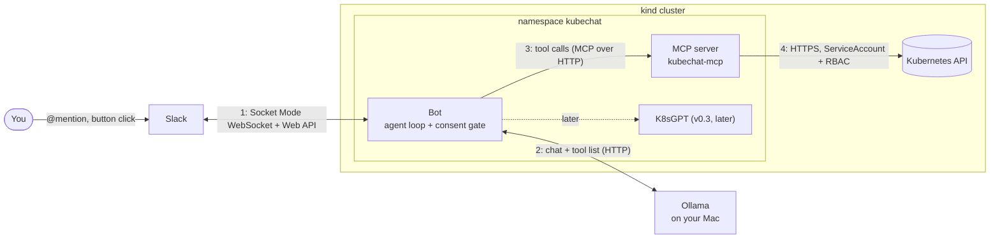

# KubeChat architecture: who talks to whom

The **bot is the hub.** It is the only part that talks to Slack, to the LLM and to the
MCP server. The LLM never calls tools itself. It only *suggests* a tool call, and the
bot runs it through the **consent gate**: reads run at once, writes wait for Approve.

## One question, step by step

1. You @mention the bot in a Slack thread. Slack sends the event over the bot's WebSocket.
2. The bot sends your question plus the tool list to **Ollama**.
3. Ollama replies with an answer, **or** with a suggested tool call (name + arguments).
4. The bot passes the call to the **consent gate**:
   - **read** tool → runs now on the MCP server;
   - **write** tool → the bot posts an Approve/Reject card and waits for your click.
5. The tool result goes back to Ollama, and steps 3–5 repeat until Ollama answers.
6. The bot posts the answer in the thread.

## Connections

| # | From → To | Protocol | Address | Auth | Set in |
|---|---|---|---|---|---|
| 1 | Bot ⇄ Slack | WebSocket (Socket Mode) for events and clicks; HTTPS Web API for posting | Slack's servers, outbound only | app token `xapp-…` (socket), bot token `xoxb-…` (posting) | `.env` → Secret `kubechat-slack` |
| 2 | Bot → Ollama | HTTP, OpenAI-compatible `/v1/chat/completions` | pod: `http://host.docker.internal:11434/v1` `go run`: `http://localhost:11434/v1` | none | `KUBECHAT_LLM_BASE_URL`, `KUBECHAT_LLM_MODEL` |
| 3 | Bot → MCP server | MCP: JSON-RPC over Streamable HTTP (`POST /mcp`, `Mcp-Session-Id` header) | pod: `http://kubechat-mcp:8080/mcp` `go run`: `http://localhost:8080/mcp` (NodePort 30080) | none (in-cluster only; NetworkPolicy in v0.4) | `KUBECHAT_MCP_URL` |
| 4 | MCP server → Kubernetes API | HTTPS (client-go) | in-cluster API server | ServiceAccount `kubechat-mcp`: `view` everywhere + scale Deployments in any namespace (the bot refuses `kube-*` and `kubechat`) | chart `values.yaml` → `mcp.rbac`, `mcp.config` |
| — | Bot → Kubernetes API | **none**: the bot has no Kubernetes permissions | — | — | — |
| later | Bot → K8sGPT | MCP over HTTP | `http://kubechat-k8sgpt:8089/mcp` | none | (v0.3) |

The bot **only makes outbound connections**. Nothing connects in to it, so it needs no
Service, ingress or public URL.

## Ports

| Port | What | Reachable from |
|---|---|---|
| 11434 | Ollama on your Mac | the Mac; pods via `host.docker.internal` |
| 8080 on `kubechat-mcp` Service | MCP server (ClusterIP) | pods in the cluster |
| 127.0.0.1:8080 on the Mac | MCP server via kind port mapping → NodePort 30080 | the Mac only (for `go run` and debugging) |

## Where each setting lives

| What | File | In the cluster |
|---|---|---|
| MCP server: tools, blocked resources, RBAC | `deploy/helm/kubechat/values.yaml` (`mcp:`) | ConfigMap + RBAC, created by the chart |
| Bot settings (no secrets) | `deploy/helm/kubechat/values.yaml` (`bot.env`) | ConfigMap `kubechat-bot`, passed as environment variables |
| Slack tokens (step 7) | `.env` (git-ignored) | Secret `kubechat-slack` |

The bot reads its settings from environment variables (`internal/config`):

| Variable | Chart value | Meaning |
|---|---|---|
| `KUBECHAT_LLM_BASE_URL` | `http://host.docker.internal:11434/v1` | Ollama's OpenAI-compatible API |
| `KUBECHAT_LLM_MODEL` | `qwen3:8b` | model name in Ollama |
| `KUBECHAT_MAX_TOOL_ROUNDS` | `8` | most LLM ↔ tool round trips per question |
| `KUBECHAT_MCP_URL` | `http://kubechat-mcp:8080/mcp` | the MCP server |
| `KUBECHAT_PROTECTED_NAMESPACES` | `kube-*,kubechat` | namespaces never changed (comma-separated patterns; code default `kube-*`) |
| `KUBECHAT_TOOL_TIERS` | `resources_scale=write` | overrides the server's hints (`tool=read\|write\|destructive\|blocked`) |
| `SLACK_BOT_TOKEN`, `SLACK_APP_TOKEN` | from Secret `kubechat-slack` | Slack tokens (step 7) |

The code's defaults allow no writes: no tool counts as a write until `KUBECHAT_TOOL_TIERS`
says so. Even then, every change needs an explicit namespace that isn't protected, and
your Approve click. Steps 7 and 8 add the Slack channel, the
approver and the approval timeout.

When the bot runs with `go run` instead of in a pod, the code's defaults already point
at `localhost` for Ollama and the MCP server.
