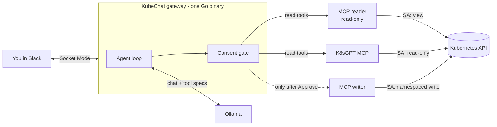
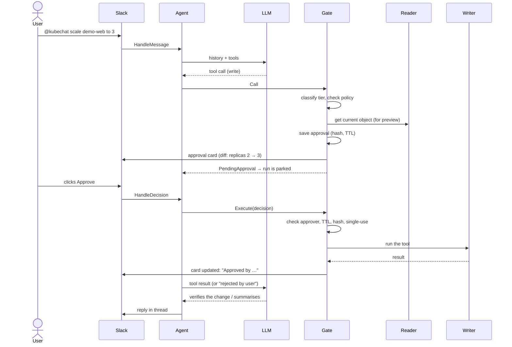

# KubeChat — Design

Slack-driven Kubernetes debugging via MCP · 11 Nov 2026 · @Krishna

## 1. Idea

KubeChat is one small Go service that turns a Slack channel into a chat front-end for a Kubernetes cluster. You ask a question in plain language ("why is checkout crashlooping?") and it answers from live cluster data: pods, events, logs, resources and metrics. When it wants to change something, it posts an approval card, and nothing changes until a human clicks **Approve**.

It reuses existing open-source pieces for everything that already exists:

| Need | Reused project |
|---|---|
| All Kubernetes access | [containers/kubernetes-mcp-server](https://github.com/containers/kubernetes-mcp-server), run twice: a **reader** and a **writer** |
| Health scans | [K8sGPT](https://github.com/k8sgpt-ai/k8sgpt) analyzers through its MCP server |
| LLM | Local model on [Ollama](https://ollama.com), through its OpenAI-compatible `/v1` API |

KubeChat adds only what no maintained project provides: the **Slack bot**, the **agent loop**, and a **consent gate**.

> **Core rule: the LLM never holds write access.**
> Reads run straight away. A write becomes an approval card in Slack. Only the gate, after a human clicks Approve, calls the separate write-scoped MCP server.

### Goals (v1)
- Answer debugging questions in Slack, grounded in live cluster data.
- Run one-shot health scans on demand (`/k8s health`).
- Propose fixes (scale, restart, image bump) and run them only after explicit approval of the exact change shown.
- Keep a full audit trail: who asked, what ran, who approved.
- Run in-cluster with no public ingress (Slack Socket Mode).

### Non-goals (v1)
- No autonomous or alert-triggered fixes.
- No access to Secret contents.
- No web UI; Slack is the only interface, plus a CLI for development.
- No multi-tenant setup; this is for one team and one to a few clusters.

## 2. Architecture

- The **gateway** is the only component that talks to Slack and the LLM. It has no Kubernetes permissions of its own.
- The **reader**, **writer** and **K8sGPT** run as separate processes, each with its own ServiceAccount, so the Kubernetes API server enforces the read/write split as well.
- During development the MCP servers run on the laptop. From the in-cluster step on they run as pods. Only URLs in `config.yaml` change.

### Ports and adapters

The core (agent, gate, policy, preview) depends only on small Go interfaces and imports only the standard library. Adapters plug in at startup in `cmd/kubechat/main.go`.

| Port | Used by | v1 adapter | Test / later adapters |
|---|---|---|---|
| `Conversations` (inbound) | chat adapters | implemented by the agent | — |
| `ChatSink` | agent | Slack thread replies | CLI, fake |
| `Approver` | gate | Slack Block Kit card | CLI y/n prompt, fake |
| `LLM` | agent | Ollama `/v1` | hosted API, scripted fake |
| `Tools` | agent, preview | MCP (reader / writer / k8sgpt), wrapped by the gate | fake cluster |
| `SessionStore`, `ApprovalStore` | agent, gate | SQLite | in-memory |
| `AuditSink` | agent, gate | JSON to stdout + Prometheus | in-memory recorder |

The **consent gate is a decorator on `Tools`**. The agent cannot tell whether it is there and has no way to reach the writer that skips it.

## 3. Flow

### Read: answering a question
1. You @mention the bot. One Slack thread is one session.
2. The agent loads the thread's history and sends it to the LLM along with the list of tools.
3. The LLM asks for read tools (list pods, logs, events, …). The gate passes them through to the reader or K8sGPT.
4. Tool output is **redacted** (tokens, keys, passwords) and **truncated** (about 200 lines or 20 KB), then given back to the LLM.
5. Steps 3–4 repeat until the LLM answers, up to a maximum number of rounds. The reply goes into the thread: cause first, then evidence.

### Write: a change with consent

Rules for writes:
- **One open change per thread.** If the LLM asks for several writes in one turn, reads run first, the first write parks the run, and the others get "deferred: one change at a time".
- **The approval is bound to the exact change**: a SHA-256 of tool + canonical args + cluster context. If anything changes, the approval is void.
- **Approvals expire after 10 minutes and are single-use.** Only configured approvers can approve. Self-approval is on for a solo setup.
- On Approve or Reject, the LLM is told the outcome, so it can verify the change or suggest something else.

## 4. Safety model

Three layers, each of which works on its own. If the LLM is fooled (for example by instructions planted in a pod log), the worst it can do without a click is read.

| Layer | What it enforces |
|---|---|
| 1. Kubernetes RBAC | Reader SA: cluster-wide `view` (no Secrets). Writer SA: namespaced Role, only in writable namespaces, with patch/update on workloads and delete on pods. Gateway SA: no cluster permissions. |
| 2. MCP server config | Reader: `read_only = true`, Secrets denied. Writer: limited `enabled_tools`; Secrets and RBAC kinds denied. A NetworkPolicy lets only the gateway reach either server. |
| 3. Consent gate | Tier check, policy, a human approval bound to a hash of the change, TTL, single use, audit log. |

### Tool tiers
At startup the gateway calls `tools/list` on every MCP server and gives each tool a tier. Order of precedence: **config override → MCP annotations → unknown = destructive** (fail closed).

| Tier | Examples | Behaviour |
|---|---|---|
| read | `pods_list`, `pods_log`, `events_list`, `resources_get`, k8sgpt analyze | Runs at once on the reader |
| write | `resources_create_or_update` (scale, image bump) | Approval card, then runs on the writer |
| destructive | `resources_delete`, `pods_delete` | Approval card with a red banner |
| blocked | deny-listed tools, denied namespaces | Refused before reaching Slack |

### Data handling
- Tool output is **untrusted data**. The system prompt tells the model never to follow instructions found in logs or resources.
- Output is redacted and size-capped before it reaches the LLM or Slack.
- Logs and YAML never leave your network. Only the replies posted to Slack do.

## 5. Build steps

Each step ends with a **Check**. Don't move on until it passes, and commit at the end of every step.

| Milestone | Steps | You can… |
|---|---|---|
| M0 Local playground | 1–6 | talk to the MCP servers, K8sGPT and Ollama by hand |
| M2 Read-only agent | 7–9 | ask "why are pods failing?" from the terminal |
| M1 + M3 Slack and health | 10–11 | do the same in Slack, plus `/k8s health` |
| M4 Consent gate | 12 | approve or reject changes from a Slack card |
| M5 In-cluster, hardened | 13–14 | run it all inside kind with no laptop processes |

| # | Step | Done when |
|---|---|---|
| 1 | Install tools: Go, Docker, kind, kubectl, Helm, Node, k8sgpt, Ollama | every tool prints a version |
| 2 | Create the kind cluster (2 nodes, `apps` and `staging` namespaces, metrics-server) | 2 Ready nodes; `kubectl top nodes` works |
| 3 | Plant three faults in `apps`: bad image, OOM, crash loop; plus a healthy `demo-web` | the three failure states are visible, and 2 web pods run |
| 4 | Run the MCP reader and writer on the laptop; explore them with MCP Inspector; record the real tool names in `docs/tools.md` | crash logs readable through MCP; the reader refuses a delete |
| 5 | Run K8sGPT's MCP server | `k8sgpt analyze` finds all three faults |
| 6 | Pull a model in Ollama and test tool calling with curl | the response contains the expected `tool_calls` |
| 7 | Repo skeleton: `internal/core` (types + ports), fakes, stdlib-only import rule | `go build` and `go test` pass |
| 8 | MCP adapter (merged tool registry) + policy (tiers, namespaces, approvers) | `kubechat tools` lists every tool with its tier |
| 9 | LLM adapter, redaction, agent loop, CLI front-end (`kubechat ask`), reads only | the CLI names all three causes with evidence |
| 10 | Slack app (Socket Mode), Slack adapter, SQLite sessions | the same answer in Slack; follow-ups keep context |
| 11 | `/k8s health` via K8sGPT, also available to the agent as a read tool | it lists the three faults |
| 12 | Consent gate: approvals, preview diff, CLI then Slack card, audit log | scale 2 → 3 works on Approve; Reject, expiry and tampering do nothing |
| 13 | Deploy into kind: images, RBAC, MCP configs, NetworkPolicy, gateway | works with all laptop processes stopped; the reader can't delete pods |
| 14 | Harden: metrics, traces, rate limits, multi-cluster `/k8s ctx`, CI safety tests | a dashboard shows tool calls by tier and approvals by outcome |

## 6. Notes from design review

Things to handle or verify during the build, by the step where they come up:

- **Step 2:** use a dedicated `dev/kubeconfig` for the kind cluster and pass it to every local server, so nothing can act on another cluster by accident.
- **Step 3:** use multi-arch images (Apple Silicon is arm64).
- **Step 5:** `k8sgpt serve` may use ports 8080/8081 by default, which clash with the MCP servers. Move it to free ports.
- **Step 6:** set Ollama's context length (`OLLAMA_CONTEXT_LENGTH`). The `/v1` API can't set it per request, and an overflow silently drops the start of the prompt.
- **Step 8:** reader and writer both offer `resources_get`, so read tools are always routed to the reader. `resources_create_or_update` takes the whole manifest as one argument, so the policy has to parse it to find the namespace, and a manifest without a namespace is refused.
- **Step 9:** the agent goes through a minimal gate that refuses every non-read call until Step 12. There is never a bypass.
- **Steps 9–12:** one run per thread at a time. A new message while a change is pending cancels that pending approval.
- **Step 13:** the built-in `view` role already covers `pods/log` and metrics but not nodes, so the reader gets an extra role for nodes.

## 7. Open questions

- [ ] Which model fits best: compare a few on the Step 9 questions.
- [ ] Which namespaces are writable in v1? (Assumed: `apps`, `staging`.)
- [ ] Should `denied_namespaces` also block **reads**, or only writes? (Recommended: writes only.)
- [ ] Are **creates** in scope for v1? The writer Role currently has no `create`.
- [ ] Do you have admin rights in a Slack workspace to install a custom app? (Needed by Step 10.)
- [x] LLM provider: local model via Ollama.
- [x] First cluster: kind on the laptop.
- [x] Solo or team: solo; you approve your own changes.
